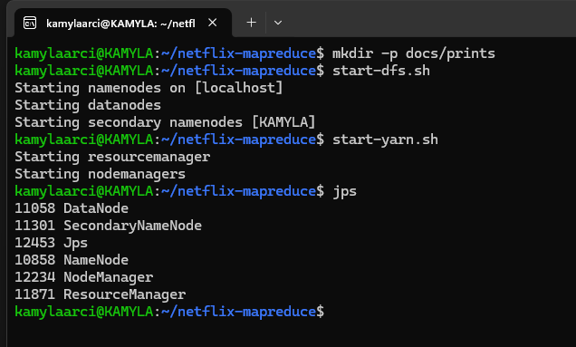
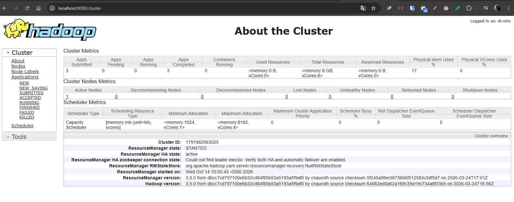
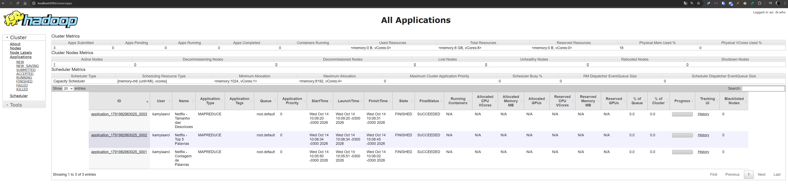
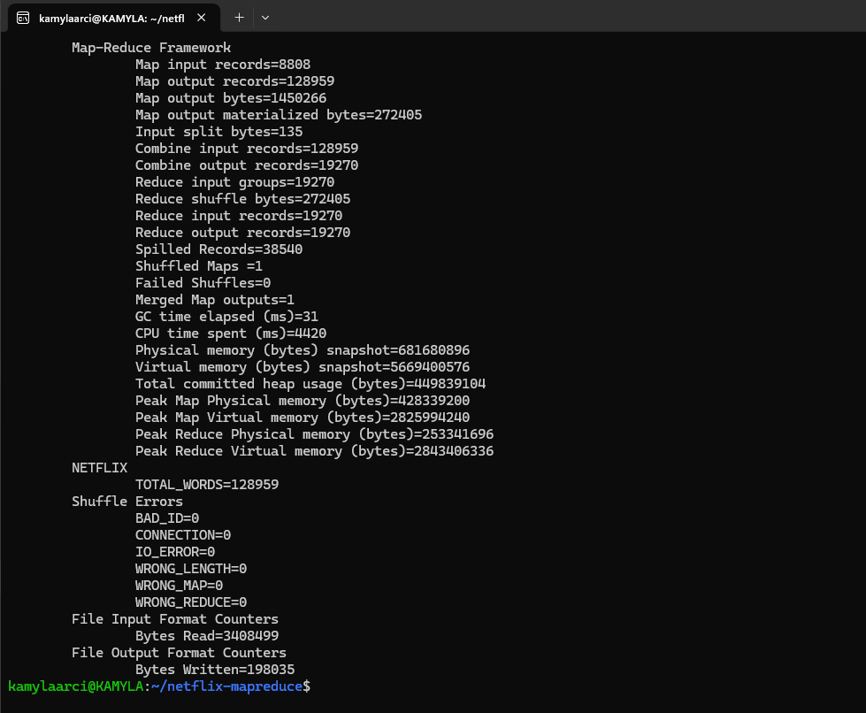
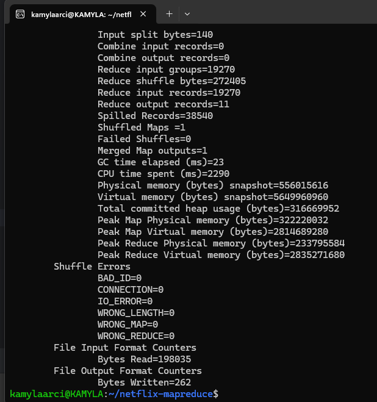
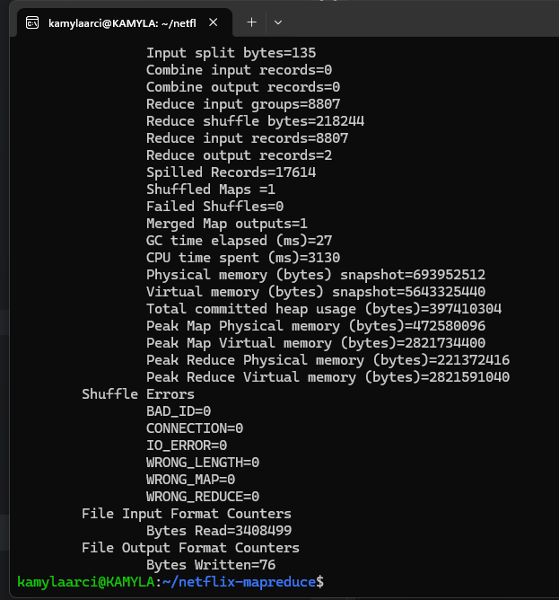
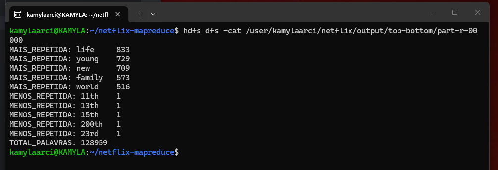
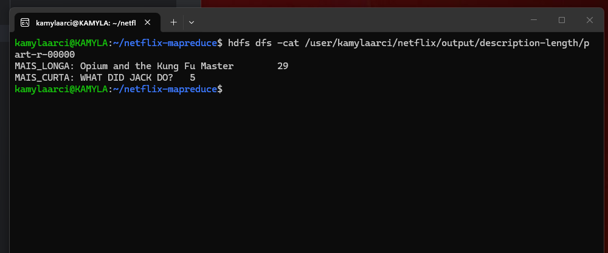

# Netflix MapReduce

Projeto desenvolvido para a disciplina de **Big Data**, utilizando **Apache Hadoop MapReduce** para realizar análises sobre as descrições de filmes e séries do dataset Netflix.

## Objetivo

O projeto utiliza Hadoop MapReduce para processar as descrições presentes no dataset e realizar as seguintes análises:

- Normalização dos textos;
- Conversão das palavras para letras minúsculas;
- Remoção de pontuações e caracteres especiais;
- Remoção de stopwords;
- Identificação do título com a descrição mais longa;
- Identificação do título com a descrição mais curta;
- Identificação das 5 palavras mais repetidas;
- Identificação das 5 palavras menos repetidas;
- Contagem do número total de palavras das descrições.

## Tecnologias utilizadas

- Java 17 (compilação)
- Apache Hadoop 3.5.0
- Hadoop HDFS
- Hadoop YARN
- Hadoop MapReduce
- Apache Maven
- Apache Commons CSV

## Dataset

Foi utilizado o dataset **Netflix Movies and TV Shows**, contendo **8.807 registros** de filmes e séries.

As principais colunas utilizadas no processamento foram:

- `title`: título do filme ou série;
- `description`: descrição utilizada para as análises textuais.

Como alguns campos do CSV possuem vírgulas entre aspas, o processamento é realizado utilizando **Apache Commons CSV**, evitando a separação incorreta dos campos.

Também foi realizada uma etapa de pré-processamento para remover quebras de linha existentes dentro de campos do CSV, permitindo que cada registro seja processado corretamente pelo Hadoop.

## Processamento de texto

Antes das análises, as descrições passam por uma etapa de normalização.

O processamento realiza:

1. Conversão do texto para minúsculas;
2. Remoção de apóstrofos (`'` e `’`), unindo as partes da palavra (ex.: `world's` → `worlds`);
3. Substituição dos demais caracteres de pontuação e caracteres especiais por espaço (ex.: `B-17` → `b 17`);
4. Separação do texto em tokens;
5. Remoção de stopwords da língua inglesa;
6. Desconsideração de tokens que possuam menos de duas letras.

A lógica de processamento está centralizada na classe `TextProcessor`, garantindo que as mesmas regras sejam utilizadas tanto na contagem das palavras quanto no cálculo do tamanho das descrições.

### Stopwords

A lista de stopwords está em `src/main/resources/stopwords.txt` e contém **126 palavras** da língua inglesa.

Como os apóstrofos são removidos na normalização, contrações como `don't` e `they're` passam a ser `dont` e `theyre`. Essas formas **não** constam na lista de stopwords e, portanto, são contabilizadas como palavras comuns. Optou-se por manter a regra simples e reproduzível: normalizar o texto e, em seguida, aplicar exatamente a lista definida em `stopwords.txt`.

### Tokens com menos de duas letras

São desconsiderados os tokens com menos de duas letras, o que elimina:

- números puros (ex.: `1000`, `17`);
- letras isoladas (ex.: o `b` de `B-17`).

Tokens que misturam números e letras, como os ordinais `11th` e `23rd`, possuem duas letras ou mais e são mantidos.

### Demonstração da normalização

A classe `TestNormalization` é um utilitário de demonstração e **não é um dos Jobs MapReduce**. Ela aplica as mesmas regras do `TextProcessor` a uma frase de exemplo e mostra o texto antes e depois da normalização:

```bash
java -cp target/netflix-mapreduce-1.0-SNAPSHOT.jar \
  br.com.kamyla.netflix.TestNormalization
```

```text
Original:
The world's story happened after 1000 missions with a B-17 aircraft.

Normalizado:
the worlds story happened after 1000 missions with a b 17 aircraft

Palavras consideradas:
worlds
story
happened
missions
aircraft
```

## Estrutura dos Jobs MapReduce

O projeto utiliza três Jobs principais.

### 1. Word Count

Responsável por processar todas as descrições e calcular a frequência de cada palavra.

Cada palavra válida é emitida pelo Mapper no formato:

```text
palavra → 1
```

O Reducer soma todas as ocorrências da mesma palavra.

Também é utilizado um **Combiner**, reduzindo a quantidade de dados enviados entre as etapas Map e Reduce.

Um Hadoop Counter chamado `TOTAL_WORDS` registra o número total de palavras consideradas durante o processamento.

### 2. Top 5 palavras e total de palavras

O segundo Job utiliza o resultado do Word Count para identificar:

- as 5 palavras mais repetidas;
- as 5 palavras menos repetidas;
- o número total de palavras, obtido pela soma das frequências de todas as palavras.

O total é gravado na saída do Job na linha `TOTAL_PALAVRAS`, de forma que o resultado não dependa apenas do Counter exibido no log.

Nos casos de empate de frequência, é utilizada a ordem alfabética como critério determinístico de desempate.

### 3. Tamanho das descrições

O terceiro Job calcula a quantidade de palavras válidas de cada descrição após a normalização e remoção das stopwords.

A partir desses valores são identificados:

- o título com a descrição mais longa;
- o título com a descrição mais curta.

É utilizado apenas um Reducer para que a comparação seja realizada considerando todo o dataset.

## Resultados

### Número total de palavras

O total considerado nas análises é **128.959 palavras**, contadas após a normalização, a remoção das stopwords e o descarte dos tokens com menos de duas letras, conforme pedido no enunciado.

| Métrica | Quantidade |
|---|---:|
| **Total após remoção de stopwords e aplicação dos filtros** | **128.959** |
| Palavras distintas consideradas | 19.270 |
| Palavras distintas com frequência igual a 1 | 9.192 |

### 5 palavras mais repetidas

| Palavra | Frequência |
|---|---:|
| life | 833 |
| young | 729 |
| new | 709 |
| family | 573 |
| world | 516 |

### 5 palavras menos repetidas

| Palavra | Frequência |
|---|---:|
| 11th | 1 |
| 13th | 1 |
| 15th | 1 |
| 200th | 1 |
| 23rd | 1 |

Das **19.270 palavras distintas**, **9.192** aparecem apenas uma vez. Por isso, foi utilizada a ordem alfabética como critério de desempate para determinar as cinco apresentadas. Como os dígitos precedem as letras nessa ordenação, as primeiras são ordinais como `11th` e `13th`.

### Descrição mais longa

```text
Opium and the Kung Fu Master
29 palavras
```

### Descrição mais curta

```text
WHAT DID JACK DO?
5 palavras
```

As quantidades das descrições consideram apenas as palavras válidas após a aplicação das regras de normalização e remoção de stopwords.

## Ambiente de execução (Hadoop no WSL2)

O Hadoop foi instalado e configurado manualmente no próprio computador, sem uso de cluster pronto, imagem Docker ou serviço em nuvem. O ambiente roda no **WSL2**, que executa um kernel Linux real sobre o Windows.

| Item | Versão / valor |
|---|---|
| Sistema | Ubuntu 24.04 LTS (WSL2) |
| Hadoop | 3.5.0 (`hadoop-3.5.0.tar.gz`, extraído em `~/hadoop`) |
| Java do Hadoop | OpenJDK 17 (`JAVA_HOME` em `hadoop-env.sh`) |
| Modo | Pseudo-distribuído (um nó) |

### Configuração

| Arquivo | Propriedade | Valor |
|---|---|---|
| `core-site.xml` | `fs.defaultFS` | `hdfs://localhost:9000` |
| `hdfs-site.xml` | `dfs.replication` | `1` |
| `hdfs-site.xml` | `dfs.namenode.name.dir` | `~/hadoop_data/hdfs/namenode` |
| `hdfs-site.xml` | `dfs.datanode.data.dir` | `~/hadoop_data/hdfs/datanode` |
| `mapred-site.xml` | `mapreduce.framework.name` | `yarn` |
| `yarn-site.xml` | `yarn.nodemanager.aux-services` | `mapreduce_shuffle` |

As variáveis `HADOOP_HOME`, `HADOOP_CONF_DIR` e o `PATH` com `bin` e `sbin` do Hadoop estão definidas no `~/.bashrc`.

### Inicialização dos serviços

```bash
start-dfs.sh
start-yarn.sh
jps
```

O `jps` deve listar `NameNode`, `DataNode`, `SecondaryNameNode`, `ResourceManager` e `NodeManager`. As interfaces web ficam em `http://localhost:9870` (HDFS) e `http://localhost:8088` (YARN).

## Compilação

Para compilar o projeto:

```bash
mvn clean package
```

O arquivo JAR é gerado em:

```text
target/netflix-mapreduce-1.0-SNAPSHOT.jar
```

## Estrutura no HDFS

O dataset utilizado pelos Jobs (já normalizado pelo `CsvNormalizer`) fica armazenado em:

```text
/user/kamylaarci/netflix/input/netflix_titles.csv
```

Os resultados são armazenados em:

```text
/user/kamylaarci/netflix/output/wordcount
/user/kamylaarci/netflix/output/top-bottom
/user/kamylaarci/netflix/output/description-length
```

## Execução

Os passos devem ser executados nesta ordem:

1. Compilação (`mvn clean package`);
2. Pré-processamento do CSV (`CsvNormalizer`);
3. Envio do CSV normalizado para o HDFS;
4. `NetflixWordCount`;
5. `NetflixTopBottom` (utiliza a saída do `NetflixWordCount`);
6. `NetflixDescriptionLength`.

### Pré-processamento do CSV

O `CsvNormalizer` remove as quebras de linha existentes dentro dos campos do CSV original. Ele é executado localmente, fora do Hadoop, utilizando o próprio JAR do projeto (que já inclui o Apache Commons CSV):

```bash
java -cp target/netflix-mapreduce-1.0-SNAPSHOT.jar \
  br.com.kamyla.netflix.preprocessing.CsvNormalizer \
  netflix_titles.csv \
  netflix_titles_normalized.csv
```

### Envio para o HDFS

O arquivo normalizado é enviado ao HDFS com o nome `netflix_titles.csv`:

```bash
hdfs dfs -mkdir -p /user/kamylaarci/netflix/input

hdfs dfs -put netflix_titles_normalized.csv \
  /user/kamylaarci/netflix/input/netflix_titles.csv
```

### Word Count

```bash
hadoop jar target/netflix-mapreduce-1.0-SNAPSHOT.jar \
  br.com.kamyla.netflix.NetflixWordCount \
  /user/kamylaarci/netflix/input/netflix_titles.csv \
  /user/kamylaarci/netflix/output/wordcount
```

### Top 5 palavras e total de palavras

```bash
hadoop jar target/netflix-mapreduce-1.0-SNAPSHOT.jar \
  br.com.kamyla.netflix.NetflixTopBottom \
  /user/kamylaarci/netflix/output/wordcount \
  /user/kamylaarci/netflix/output/top-bottom
```

### Descrição mais longa e mais curta

```bash
hadoop jar target/netflix-mapreduce-1.0-SNAPSHOT.jar \
  br.com.kamyla.netflix.NetflixDescriptionLength \
  /user/kamylaarci/netflix/input/netflix_titles.csv \
  /user/kamylaarci/netflix/output/description-length
```

## Visualização dos resultados

Para visualizar o Top 5 e o total de palavras:

```bash
hdfs dfs -cat /user/kamylaarci/netflix/output/top-bottom/part-r-00000
```

```text
MAIS_REPETIDA: life	833
MAIS_REPETIDA: young	729
MAIS_REPETIDA: new	709
MAIS_REPETIDA: family	573
MAIS_REPETIDA: world	516
MENOS_REPETIDA: 11th	1
MENOS_REPETIDA: 13th	1
MENOS_REPETIDA: 15th	1
MENOS_REPETIDA: 200th	1
MENOS_REPETIDA: 23rd	1
TOTAL_PALAVRAS:	128959
```

Para visualizar os resultados referentes ao tamanho das descrições:

```bash
hdfs dfs -cat /user/kamylaarci/netflix/output/description-length/part-r-00000
```

```text
MAIS_LONGA: Opium and the Kung Fu Master	29
MAIS_CURTA: WHAT DID JACK DO?	5
```

### Reexecução dos Jobs (opcional)

O Hadoop não grava a saída de um Job em um diretório que já existe. Para executar os Jobs novamente, apague antes as saídas anteriores:

> **Atenção:** estes comandos apagam definitivamente os resultados das execuções anteriores no HDFS.

```bash
hdfs dfs -rm -r -f /user/kamylaarci/netflix/output/wordcount
hdfs dfs -rm -r -f /user/kamylaarci/netflix/output/top-bottom
hdfs dfs -rm -r -f /user/kamylaarci/netflix/output/description-length
```

## Resultados da execução final

Na execução final, o Hadoop processou os **8.807 registros** do dataset sem registros inválidos nas análises.

O Word Count contabilizou, pelo Counter:

```text
TOTAL_WORDS=128959
```

Esse valor coincide com a linha `TOTAL_PALAVRAS` gravada na saída do Job Top 5.

O uso do Combiner reduziu os registros intermediários enviados para a etapa de Reduce, conforme os contadores registrados pelo Hadoop:

```text
Map output records=128959
Combine input records=128959
Combine output records=19270
Reduce input records=19270
```

Como o dataset foi processado por uma única tarefa Map, o Combiner agrupou todas as ocorrências de cada palavra, e o Reducer recebeu exatamente um registro por palavra distinta (19.270). Com mais tarefas Map, esse número poderia ser maior, pois cada tarefa combina apenas os seus próprios dados.

O Job responsável pelo tamanho das descrições recebeu os `8807` títulos e produziu os dois resultados finais correspondentes à maior e à menor descrição.

## Evidências de execução

Capturas de tela da execução no ambiente local (Hadoop no WSL2):

### Serviços em execução (`jps`)



### Cluster YARN (versão do Hadoop)



### Jobs concluídos no YARN



### Contadores dos Jobs

Word Count, com os contadores do Combiner e o `TOTAL_WORDS`:



Top 5 palavras:



Tamanho das descrições:



### Saídas no HDFS




